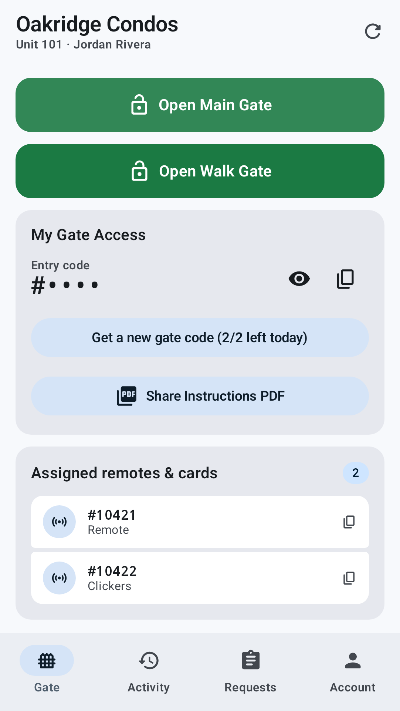
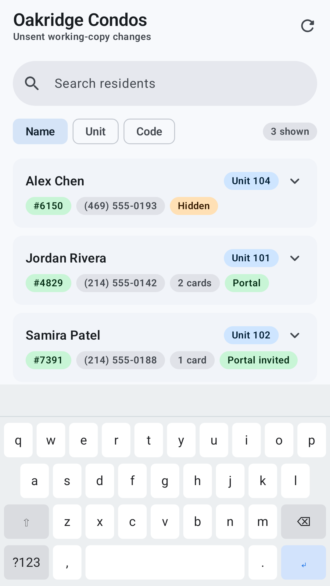
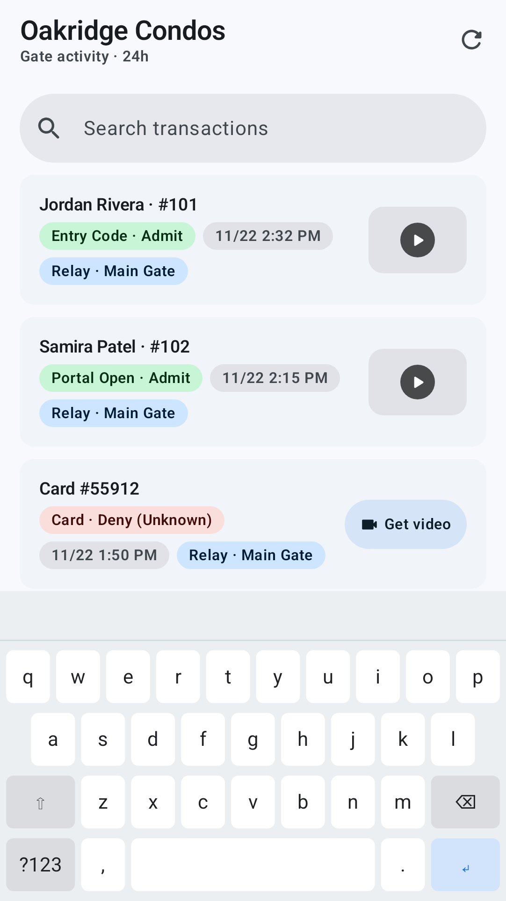

# Doorking Gate (Android)

Native Kotlin + Jetpack Compose (Material 3) Android app for managing DoorKing telephone-entry gates through a self-hosted [DoorKing Gate Manager API](https://github.com/rouing/doorking-api).

## Screenshots

| Resident Portal | Admin Residents | Gate Activity | Live Relays |
| :---: | :---: | :---: | :---: |
|  |  |  |  |

## Features

### Resident Portal
- **Buzz Me In** — open community gates from the app, the 3×2 Material 3 home-screen widget (Jetpack Glance), or **Android Auto** (`androidx.car.app.category.IOT`).
- **Personal Keypad Code** — masked 4-digit code with 30-second auto-remask, one-tap copy, self-service code reroll, and printable welcome PDF export.
- **Activity & Requests** — view personal gate access history (with camera snapshots/clips when enabled), flag unfamiliar activity, and submit contact/remote change requests.

### Staff & HOA Admin
- **Residents & Vendors Directory** — search, add/edit/remove entries in a local working copy, resolve sync conflicts, generate safe non-colliding keypad codes, and share resident welcome PDFs.
- **Safe Staging Before Sync** — preview exact field-by-field diffs before sending updates to the physical gate over DKS Cloud, with live job logs and revertible change history.
- **Live Relays & Timed Hold-Open** — view live relay status, hold gates open, and set automatic release timers.
- **Gate Activity, Insights & Media** — browse access logs, view authenticated camera snapshots and H.265 clips (Coil 3 + Media3 ExoPlayer), and audit dormant codes or unknown cards.
- **Full Board & System Settings** — Facility Codes, US Holidays, Security Levels, Hold Open, 2-Line/8-Line Display, Anti-Pass Back, Scheduled Transfers, Users, Scoped API Keys, Webhooks, and Portal Review Queues.

### Security & Platform
- **Authentication** — password, Android Credential Manager passkeys, Chrome Custom Tabs OIDC SSO (RFC 8252 PKCE), and passkey or password step-up confirmation.
- **Encrypted Session Storage** — bearer tokens encrypted at rest with AES-256-GCM in Android Keystore (`EncryptedSessionStore`).
- **Push Notifications & Diagnostics** — optional Firebase Cloud Messaging (FCM) push alerts, Firebase Crashlytics (zero analytics), and Google Play Flexible In-App Updates.

## Requirements

- **Android:** API 34+ (Android 14+), compiled & targeted against Android 17 (API 37.1)
- **JDK:** 21+ (Gradle uses JVM toolchain 21)
- **Android SDK:** Platforms 37.1 + Build-Tools 37.0.0
- **Backend:** Running instance of [`doorking-api`](https://github.com/rouing/doorking-api) over HTTPS

## Local Setup & Configuration

Clone the repository and configure your local (gitignored) files:

```bash
git clone https://github.com/rouing/doorking-android.git
cd doorking-android
```

1. **Android SDK path (`local.properties`, gitignored):**
   ```properties
   sdk.dir=/path/to/Android/Sdk
   ```
2. **Release signing & defaults (`keystore.properties`, gitignored — optional for debug builds):**
   ```properties
   storeFile=doorking-release.jks
   storePassword=YOUR_STORE_PASSWORD
   keyAlias=doorking
   keyPassword=YOUR_KEY_PASSWORD
   defaultServerUrl=https://gate.example.com

   # Optional: Google Play automated publishing (Triple-T Gradle Play Publisher)
   playServiceAccountCredentials=/path/to/play-publisher.json
   playUniversalApkSyncScript=/path/to/sync-universal-apk.mjs
   playUniversalApkOutput=/path/to/doorking-gate.apk
   ```
   If `keystore.properties` is omitted, `defaultServerUrl` defaults to `https://gate.example.com`.
3. **Firebase Push & Crashlytics (optional, gitignored):**
   Drop your Firebase project's `google-services.json` at `app/google-services.json`. The Google Services and Crashlytics Gradle plugins activate automatically when that file is present and are skipped cleanly when absent.

## Building & Testing

```bash
# Run local unit tests
./gradlew testDebugUnitTest

# Build debug APK
./gradlew assembleDebug

# Build signed, R8-optimized release APK & Play App Bundle (.aab)
./gradlew assembleRelease bundleRelease
```

### Publishing to Google Play (Optional)

```bash
# Upload AAB to Internal Testing (and auto-sync Play-signed universal APK when configured)
./gradlew publishReleaseBundle

# Promote Internal Testing release to Closed Testing - Alpha
./gradlew promoteReleaseArtifact

# Or publish directly to a specific track
./gradlew publishReleaseBundle -PplayTrack=alpha
```

## Server Verification (`assetlinks.json`)

For Android Credential Manager passkeys and verified App Links, configure your `doorking-api` server's `config.json`:

```json
"android": {
  "packageName": "com.doorking.gate",
  "sha256CertFingerprints": ["AA:BB:CC:..."],
  "apkPath": "/path/to/doorking-gate.apk"
}
```

## Related Repositories

- [`rouing/doorking-api`](https://github.com/rouing/doorking-api) — Headless Fastify REST API, DKS Cloud worker & PostgreSQL backend
- [`rouing/doorking-webui`](https://github.com/rouing/doorking-webui) — Standalone React + MUI Progressive Web App
- [`rouing/doorking-mcp`](https://github.com/rouing/doorking-mcp) — MCP server for AI assistants (stdio + Streamable HTTP / OAuth 2.1)

## Disclaimer

Doorking Gate is an independent open-source project and is not affiliated with or endorsed by DoorKing, Inc.

## License

MIT
