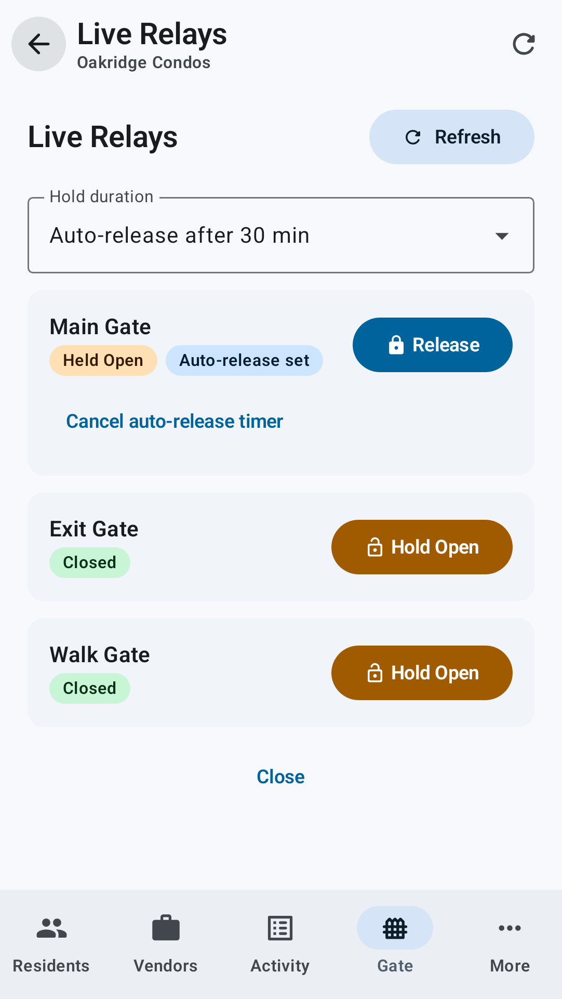

# Doorking Gate (Android)

Native Kotlin + Jetpack Compose (Material 3) Android app for managing DoorKing telephone-entry gates through a self-hosted [DoorKing Gate Manager API](https://github.com/rouing/doorking-api).

## Screenshots

| Resident Portal | Admin Residents | Gate Activity | Live Relays |
| :---: | :---: | :---: | :---: |
|  |  |  |  |

## Features

### Resident & Staff Gate Access
- **Buzz Me In Everywhere** — open permitted community gates from the app, home-screen widgets, Quick Settings tiles, **Android Auto**, or **Android 16+ AppFunctions** voice assistants.
- **Freely Resizable Multi-Relay Widget & 1×1 Shortcuts** — Jetpack Glance `GateQuickWidget` (adapts from a compact 1×1 lock tile to a multi-relay grid showing all visible relays) plus dedicated 1×1 per-relay `RelaySingleWidget` shortcuts (`RelayWidgetConfigActivity`) and one-tap home-screen pinning from User Settings.
- **Android Quick Settings Tiles** — dynamic pull-down tiles (`GateRelayTile1Service`–`GateRelayTile4Service` managed by `GateRelayTileManager`, enabling one tile per visible relay), lock-screen `unlockAndRun` support, and one-tap tile addition via `StatusBarManager.requestAddTileService`.
- **Android 16+ AppFunctions (Gemini Voice Control)** — `androidx.appfunctions:1.0.0` + KSP (`DoorkingAppFunctionService` & `GateAppFunctionLogic`) exposing `listOpenableGateRelays`, `getGateStatus`, and `openGateRelay` so on-device AI assistants can list entrances, check status, and buzz open gates.
- **Android Auto IoT** — `DoorkingCarAppService` & `ResidentGateCarScreen` (`androidx.car.app.category.IOT`) with lock/unlock state icons and lightweight live status/cooldown polling (`refreshStatusesOnly` every 2s while active, 10s idle).
- **Personal Keypad Code & Activity** — masked 4-digit code with 30-second auto-remask, one-tap copy, self-service code reroll, printable welcome PDF export (`PdfShareHelper`), personal gate activity with camera snapshots/clips, unfamiliar-activity reporting, and contact/remote change requests.

### Staff & HOA Admin
- **Top-Bar Portal Switcher** — staff and admins who also have a resident unit (`hasOwnPortalUnit`) can switch between the Staff Gate Console and Resident Portal from the top bar.
- **Residents & Vendors Directory** — search, add/edit/remove entries in a local working copy (automatically hiding reserved Unit `000` and empty slots), resolve sync conflicts, generate safe non-colliding keypad codes, and share resident welcome PDFs.
- **Gate Control & Safe Staging** — preview field-by-field diffs before sending updates to the physical gate over DKS Cloud, with a log-parsed `%` progress bar, expandable raw connection log (`GateControlSheet`), and revertible change history (ordered Gate users → Past pulls → Events in `HistoryScreen`).
- **Live Relays & Timed Hold-Open** — view live relay status, hold gates open, and set automatic release timers; admins can also configure which relays appear in the Resident Portal.
- **Gate Activity, Insights & Camera Relay Mapping** — browse access logs (with failed entry-code headlines `Entry Code · #<code/num>` and optional `hidePortalHoldNoise` filtering), view authenticated camera snapshots and H.265 clips (Coil 3 + Media3 ExoPlayer) mapped per camera channel to specific gate relays, and audit dormant codes or unknown cards.
- **Board & System Settings** — Facility Codes, US Holidays, Security Levels, Hold Open, factory-default-aware 2-Line/8-Line LCD Display, conditional Anti-Pass Back (with combined Scheduled Re-Sync card), named relay labels across Security/Hold Open/APB, Scheduled Transfers, Users, Scoped API Keys, Webhooks, and Portal Review Queues.

### User Settings, Security & Platform
- **User Settings (`AccountSettingsScreen`)** — shared across Resident and Staff views: borderless segmented Appearance selector (System / Light / Dark), Visible gate relays filter with one-tap Widget pin and Quick Settings tile add, Email & Phone, Notifications, Push devices, Fingerprint unlock toggle, **Connected AI Clients** OAuth session/grant revoke list, Passkeys, and Password.
- **Onboarding & Authentication** — native `doorking://invite` deep link onboarding (`AcceptInviteScreen` with HTTPS enforcement), password sign-in, Android Credential Manager passkeys (`PasskeyManager`), and Chrome Custom Tabs OIDC SSO (`doorking://sso/callback`, RFC 8252 PKCE).
- **Immediate Biometric App Lock & Hardware Keystore Step-Up** — immediate `BiometricLockOverlay` on app launch/resume (5-second background grace period) plus **Hardware Keystore ECDSA P-256 `CryptoObject` Fingerprint Step-Up** (`BiometricKeyManager` with `AUTH_BIOMETRIC_STRONG` hardware signing), Passkey, or Password step-up confirmation (`StepUpConfirmationDialog`).
- **Push-Notification Passkey Approval** — high-priority FCM push prompts (`PasskeyApprovalDialog`) with 2-digit number matching signed via the Android Hardware Keystore to approve web or AI client sign-ins from the phone.
- **Encrypted Session Storage** — long-lived mobile bearer session credentials encrypted at rest with AES-256-GCM in Android Keystore (`KeystoreTokenCipher` + `EncryptedSessionStore`).
- **Push Notifications & Diagnostics** — optional Firebase Cloud Messaging (FCM) push alerts, Firebase Crashlytics (zero analytics), and Google Play Flexible In-App Updates (`PlayInAppUpdateController`).

## Architecture Overview

- **`DoorkingApp` & `MainActivity`** — lightweight `AppContainer` dependency injection, shared authenticated Coil 3 `ImageLoader`, deep link streams (`doorking://invite`, `doorking://sso/callback`), `BiometricLockOverlay`, `PasskeyApprovalDialog`, and `PlayInAppUpdateController`.
- **`core/auth/`** — `KeystoreTokenCipher` (AES-256-GCM), `EncryptedSessionStore` (DataStore), `BiometricUnlockManager`, `BiometricKeyManager` (AndroidKeyStore ECDSA P-256 `CryptoObject` signer), `AndroidPasskeyManager` (`androidx.credentials`), and `UiStepUpCoordinator`.
- **`core/network/` & `core/media/`** — `DoorkingAuthInterceptor` (bearer auth + `403 stepUp` / `mustChangePassword` handling), `DoorkingApi` (Retrofit + `kotlinx.serialization`), `MediaViewerDialog` (Coil 3 + Media3 ExoPlayer), `LiveCameraDialog`, and `PdfShareHelper`.
- **`navigation/` & `feature/`** — Jetpack Navigation 3 (`NavDisplay`) driving `auth/`, `gates/`, `portal/` (`ResidentPortalScreen`), `staff/` (`StaffGateShell`, `DirectoryTab`, `TransactionsTab`, `GateControlSheet`), and `admin/` (`InsightsScreen`, `HistoryScreen`, `SchedulesScreen`, `BoardSettingsScreen`, `SystemSettingsScreen`, `AccountSettingsScreen`).
- **`widget/`, `tile/`, `car/`, `ai/`** — Jetpack Glance widgets (`GateQuickWidget`, `RelaySingleWidget`), Quick Settings tiles (`GateRelayTileService`), Android Auto IoT (`DoorkingCarAppService`), and Android 16+ AppFunctions (`DoorkingAppFunctionService`).

## Requirements

- **Android:** API 34+ (Android 14+), compiled & targeted against Android 17 (API 37.1)
- **JDK:** 21+ (Gradle uses JVM toolchain 21)
- **Android SDK:** Platforms 37.1 + Build-Tools 37.0.0
- **Backend:** Running instance of [`doorking-api`](https://github.com/rouing/doorking-api) over HTTPS

## Local Setup & Configuration

Clone the repository and configure your local (gitignored) files:

```bash
git clone https://github.com/rouing/doorking-android.git
cd doorking-android
```

1. **Android SDK path (`local.properties`, gitignored):**
   ```properties
   sdk.dir=/path/to/Android/Sdk
   ```
2. **Release signing & defaults (`keystore.properties`, gitignored — optional for debug builds):**
   ```properties
   storeFile=doorking-release.jks
   storePassword=YOUR_STORE_PASSWORD
   keyAlias=doorking
   keyPassword=YOUR_KEY_PASSWORD
   defaultServerUrl=https://gate.example.com

   # Optional: Google Play automated publishing (Triple-T Gradle Play Publisher)
   playServiceAccountCredentials=/path/to/play-publisher.json
   playUniversalApkSyncScript=/path/to/sync-universal-apk.mjs
   playUniversalApkOutput=/path/to/doorking-gate.apk
   ```
   If `keystore.properties` is omitted, `defaultServerUrl` defaults to `https://gate.example.com`.
3. **Firebase Push & Crashlytics (optional, gitignored):**
   Drop your Firebase project's `google-services.json` at `app/google-services.json`. The Google Services and Crashlytics Gradle plugins activate automatically when that file is present and are skipped cleanly when absent.

## Building & Testing

```bash
# Run local unit tests
./gradlew testDebugUnitTest

# Build debug APK
./gradlew assembleDebug

# Build signed, R8-optimized release APK & Play App Bundle (.aab)
./gradlew assembleRelease bundleRelease
```

### Publishing to Google Play (Optional)

```bash
# Upload AAB to Internal Testing (and auto-sync Play-signed universal APK when configured)
./gradlew publishReleaseBundle

# Promote Internal Testing release to Closed Testing - Alpha
./gradlew promoteReleaseArtifact

# Or publish directly to a specific track
./gradlew publishReleaseBundle -PplayTrack=alpha
```

## Server Verification (`assetlinks.json`)

For Android Credential Manager passkeys and verified App Links, configure your `doorking-api` server's `config.json`:

```json
"android": {
  "packageName": "com.doorking.gate",
  "sha256CertFingerprints": ["AA:BB:CC:..."],
  "apkPath": "/path/to/doorking-gate.apk"
}
```

## Related Repositories

- [`rouing/doorking-api`](https://github.com/rouing/doorking-api) — Headless Fastify REST API, DKS Cloud worker & PostgreSQL backend
- [`rouing/doorking-webui`](https://github.com/rouing/doorking-webui) — Standalone React + MUI Progressive Web App
- [`rouing/doorking-mcp`](https://github.com/rouing/doorking-mcp) — MCP server for AI assistants (stdio + Streamable HTTP / OAuth 2.1)

## Disclaimer

Doorking Gate is an independent open-source project and is not affiliated with or endorsed by DoorKing, Inc.

## License

MIT
